<p align="center">
  <picture>
    <source media="(prefers-color-scheme: dark)" srcset="docs/brand/dark_logo@2x.png">
    
  </picture>
</p>

<p align="center"><b>English</b> · <a href="README.pt.md">Português</a></p>

A personal dashboard for Home Assistant, inspired by Apple Home. It organises your home
by room automatically (Areas → Devices → Entities), with no YAML, and adds a 3D view of
your house that you can draw yourself. Original code, built from scratch.

## Screenshots

| Home | 3D Home |
|---|---|
| 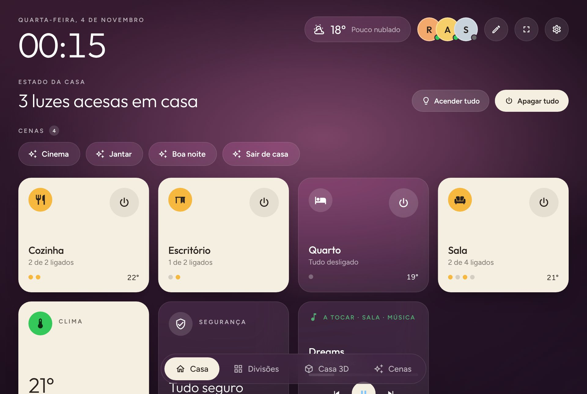 | 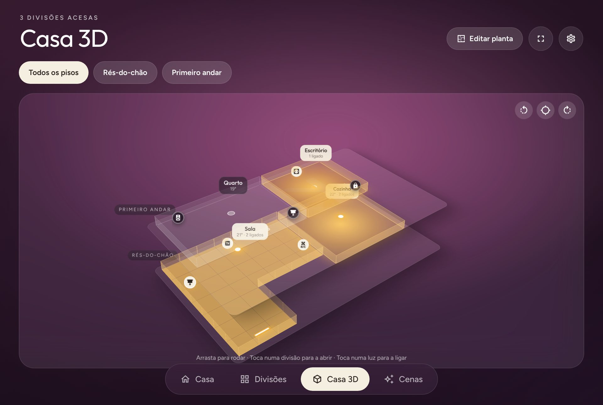 |
| **Room** | **Weather forecast** |
| 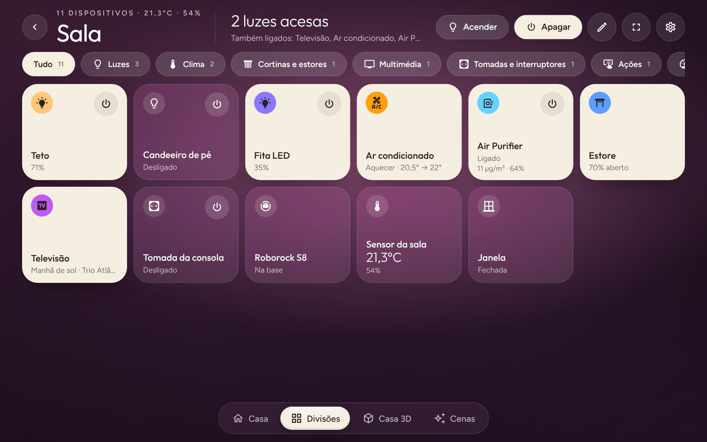 | 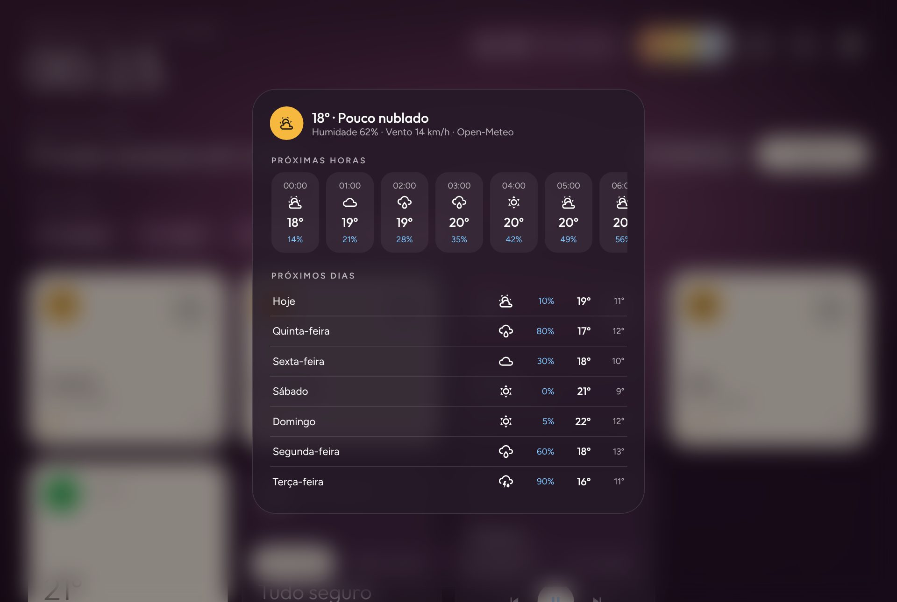 |
| **Floor plan: free shapes** | **Floor plan: devices** |
| 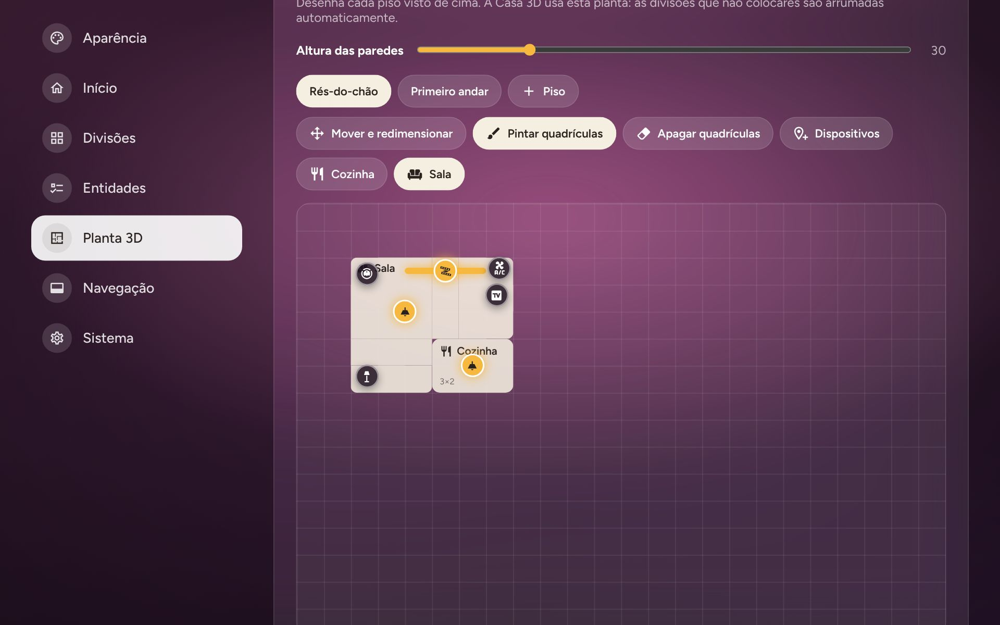 | 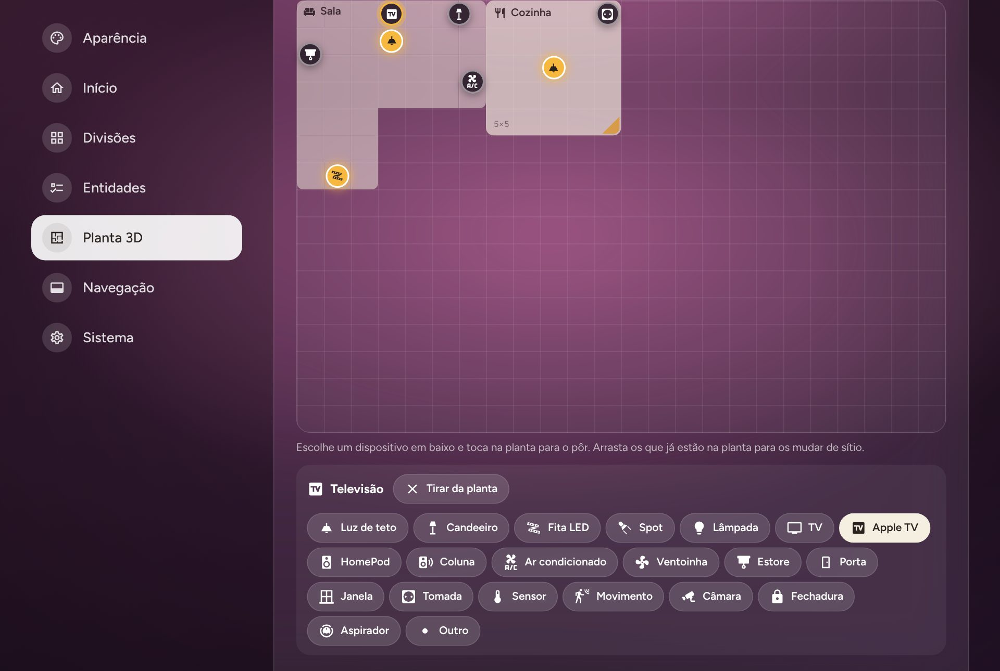 |
| **3D Home, ground floor** | **Edit mode** |
| 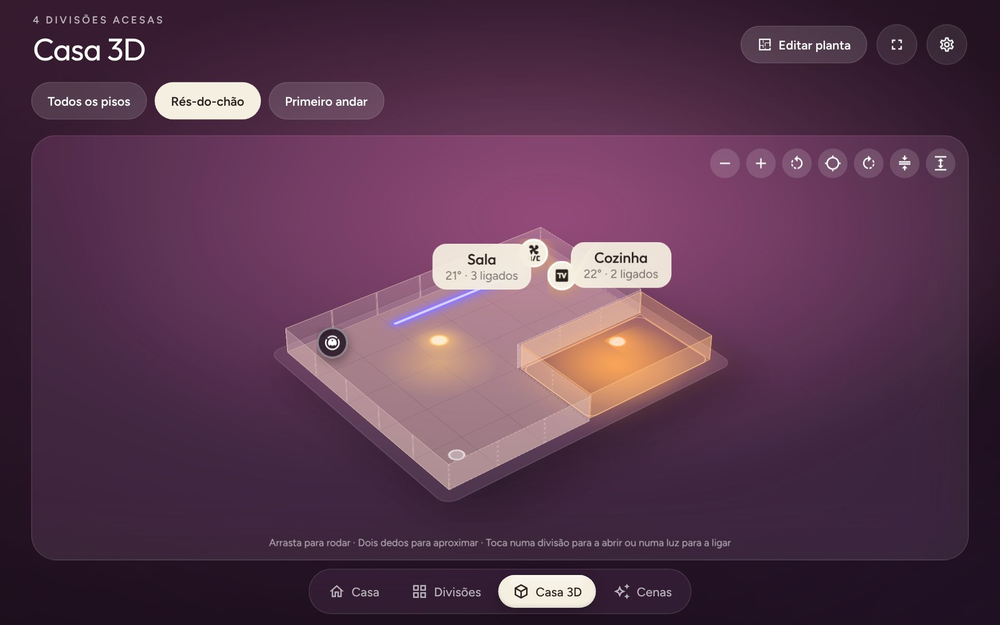 | 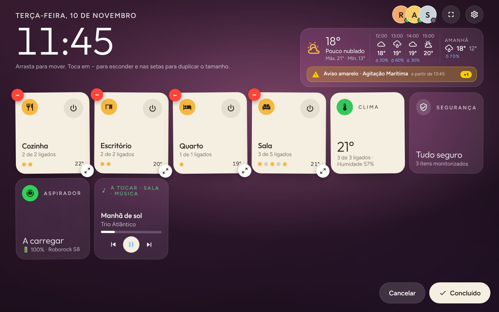 |
| **Settings: appearance** | **Settings: entities** |
| 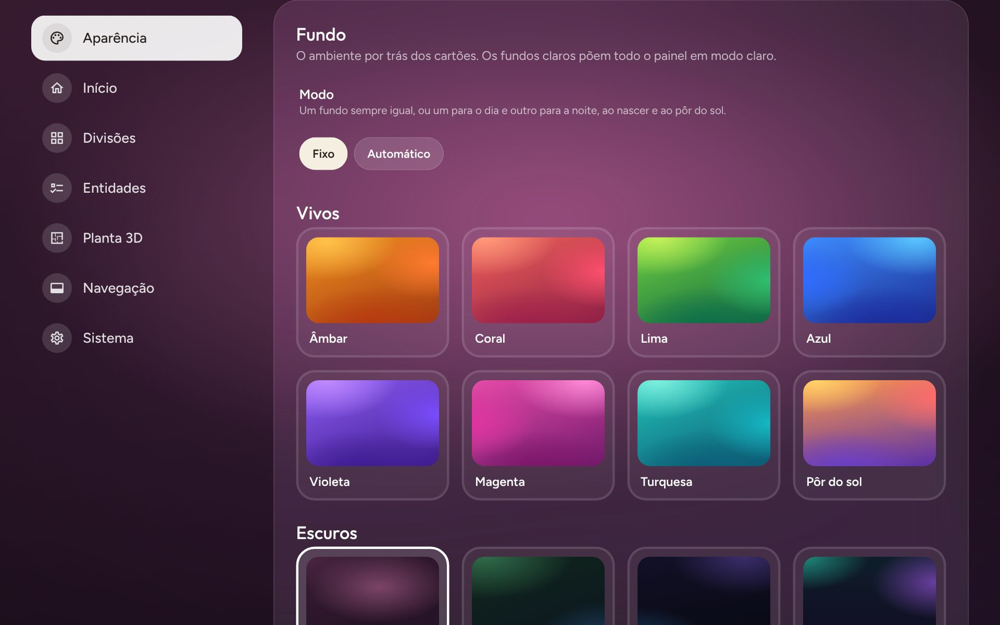 | 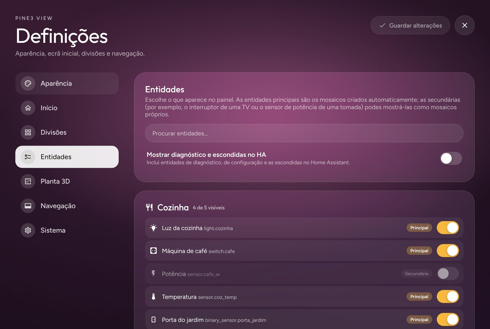 |
| **This device (full screen)** | **List layout, in English** |
| 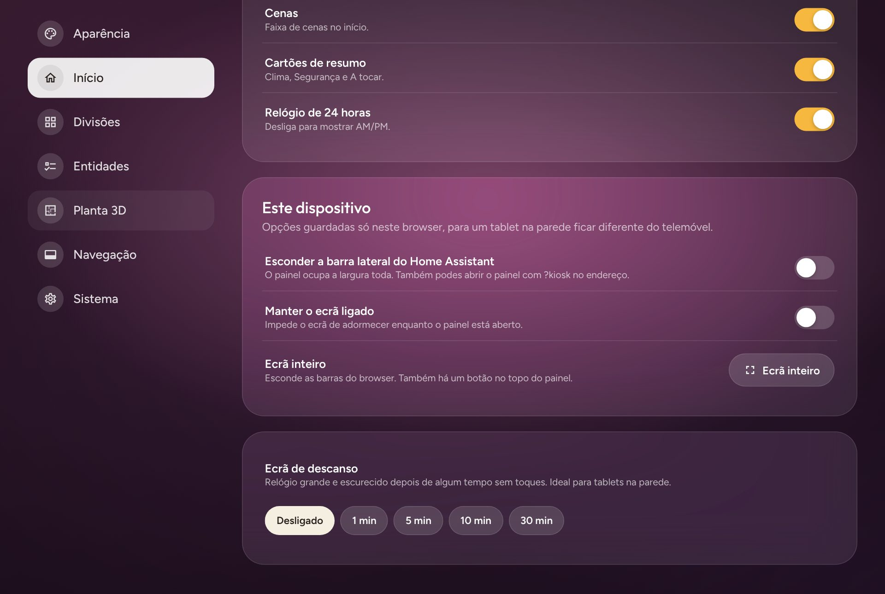 | 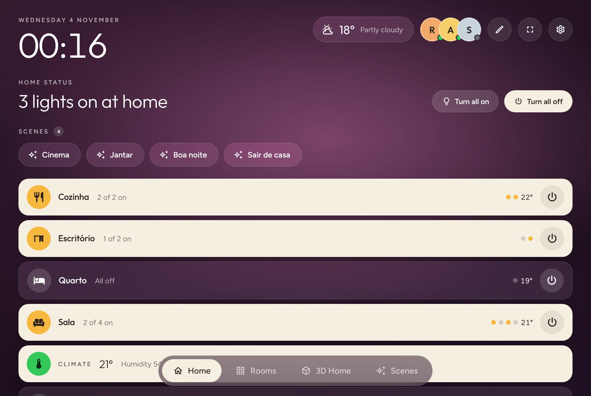 |
| **Screensaver** | |
| 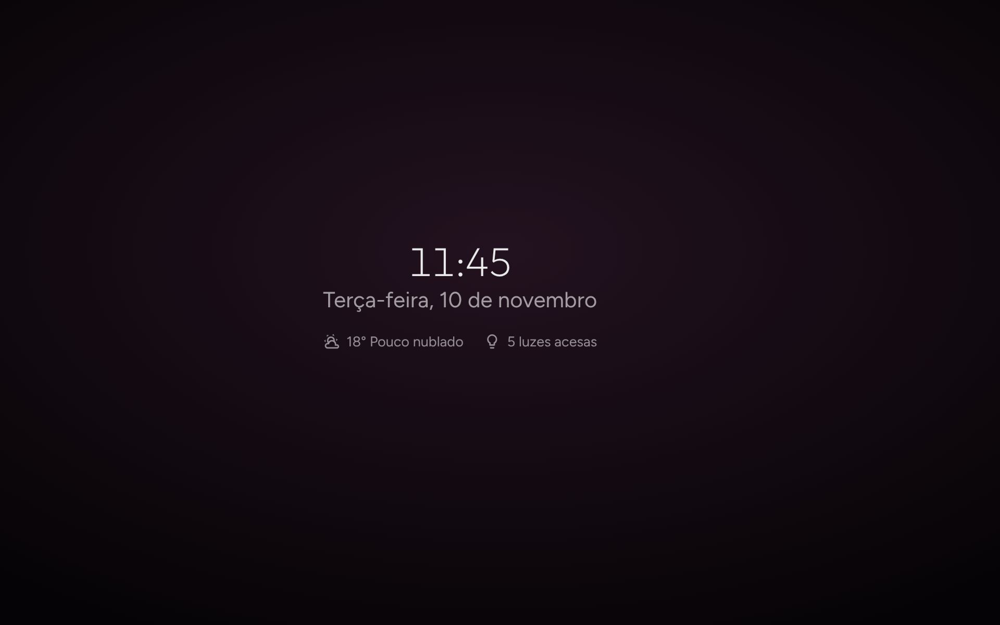 | |

On a phone:

| Home | Light details | 3D Home |
|---|---|---|
| 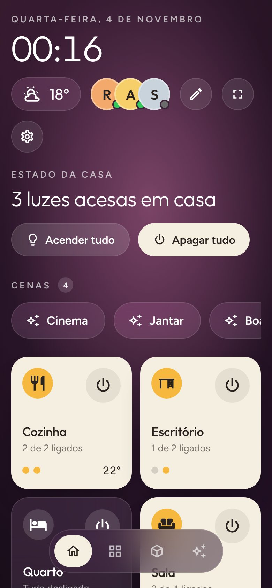 | 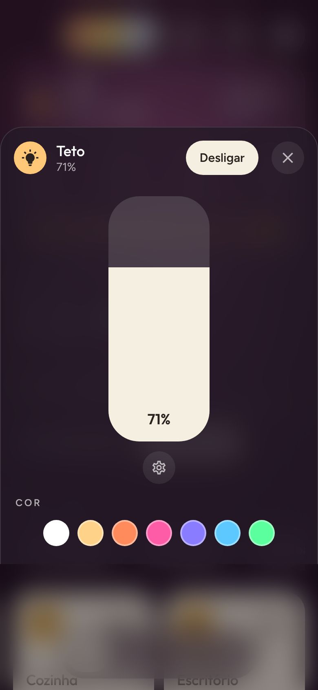 | 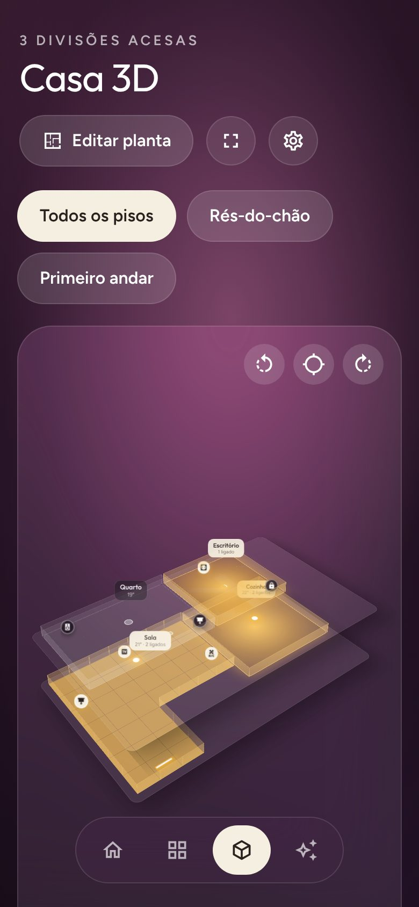 |

*Screenshots taken with a sample home; most show the Portuguese interface (English is one tap away in Settings).*

## Install with HACS
1. In Home Assistant open **HACS** → **⋮** menu → **Custom repositories**.
2. Repository: `https://github.com/pinheirofilipem-ux/pine3-view`, type **Integration** → **Add**.
3. Search for **Pine3 View**, open it and select **Download**.
4. Restart Home Assistant.
5. **Settings → Devices & services → Add integration → Pine3 View**.
6. Open **Pine3 View** in the sidebar.

Requires Home Assistant 2024.7 or newer (the integration icon needs 2026.3 or newer). To update,
download the new version in HACS and restart Home Assistant; the browser picks up the new files on its own.

### Manual install
Copy `custom_components/pine3_view` to `/config/custom_components/`, restart and add the integration.

## Features
- **Home layouts** (*Settings → Home → Home layout*): **Big clock** (a large clock with the home status beside it), **Two columns** (a third for the date, a big clock, weather, people and what is on; two thirds for Lights on/off, scenes and the cards in rows of four) or **Classic**. Big clock and Two columns also show a **weather card**: now (temperature, condition, today's high and low), the next hours with rain chance, and tomorrow; tap it for the full forecast. The home status lists what else is on besides the lights (plugs, purifiers, TVs, AC…).
- **Home**: clock, weather (tap for the forecast), people, home status with *Lights on/off* (lights only: plugs and switches stay as they are), scenes (an activated scene stays highlighted while its devices are on, until a later scene sets the same devices, so scenes for different rooms can be on together; tap it again to turn them off), room cards and summary cards (Climate, Security, Now playing).
- **Weather**: uses your Home Assistant weather entity or, if there is none, [Open-Meteo](https://open-meteo.com) for your home's location (no API key). Forecast for the next 12 hours and 7 days.
- **3D Home**: every room is a block, stacked by floor (Home Assistant floors). Lit rooms glow in the colour and brightness of their lights (each light casts a pool of its own colour on the floor), lights show as points you can toggle, drag to rotate (the house turns with your finger), zoom with two fingers, the mouse wheel or the + and − buttons, and tap a room to open it. A tap near a light toggles it, even if you miss it slightly. Each floor's slab is only as big as its rooms, and the **wall height** is adjustable (↕ buttons in the 3D Home or a slider in Settings).
- **Floor-plan editor** (*Settings → 3D floor plan*, or *Edit floor plan* in the 3D Home), a top view of one floor at a time:
  - **Move and resize**: draw rooms as rectangles, drag to move, drag the corner to resize, move rooms between floors or add floors. *Generate automatic plan* gives you a starting point.
  - **Paint / erase cells**: give a room any right-angled shape (L, U, T…). Painting over another room hands those cells over.
  - **Devices**: put each entity where it really is. Its type is detected automatically (ceiling light, lamp, LED strip, spotlight, TV, Apple TV, HomePod, speaker, air conditioner, blind, door, window, plug, sensor, camera…) and can be changed. LED strips also get a length and an angle. In the 3D Home lights glow in place (ceiling lights up high, LED strips as a line of their real length and direction) and other devices are icons that open their details.
  - Rooms you don't place are arranged automatically.
- **Entities** (*Settings → Entities*): every entity of each room, with search. Hide tiles you don't want, or show secondary entities (a TV's power switch, a plug's power sensor, diagnostic sensors) as tiles of their own.
- **Whole-device cards**: a device's detail card shows everything it exposes — readings in a grid (PM2.5, allergen index, humidity, filter life…) and its controls (switches, options, numbers, buttons), plus fan/purifier preset modes. Option lists (lamp mode, timer…) are compact tiles that open a row of chips. Great for air purifiers (e.g. Philips), vacuums or AC units; a double-size tile shows up to 6 readings.
- **Compact rooms**: inside a room, categories (Lights, Climate, Media…) take only the columns they need and share rows, so a room with many devices nearly always fits on one screen.
- **Climate and air conditioning** (e.g. Tado via HomeKit): a ring with the target temperature or the heat/cool range (low and high), what the unit is doing now (heating, cooling, idle…), current temperature and humidity, the HVAC modes and, when the unit exposes them, fan speed, swing and preset chips. Thermostats and AC units get their own icons.
- **Climate screen**: every air conditioner and thermostat on one screen, each with its current temperature, what it is doing, − and + buttons for the target and a power button (tap the card for every control), plus the temperature and humidity of each room. With more than one device, the Climate card on the home screen opens it; it can also go in the dock (*Settings → Navigation*).
- **Robot vacuum** (e.g. the official *Roborock* integration): one card for the robot and its dock. Tapping the vacuum opens a card with battery, status (and the error, if any), Start/Pause, Back to dock and Locate, suction power, **cleaning chosen rooms** (the rooms of the map in use come from `roborock.get_maps`), the map and the everyday controls (mop mode, dust emptying…). Maintenance (consumables and resets), robot settings and diagnostics are folded into sections that open with a tap. The home screen has a **Vacuum** card with its status, battery and, while cleaning, progress; tapping it opens the robot's card (it never starts it).
- **TVs** (e.g. via HomeKit): a TV icon, a power button on the tile and a card with its **inputs** (HDMI, apps…), the current source and only the controls the TV supports (playback, volume).
- **Apple TV and HomePod** (Home Assistant's *Apple TV* integration): their own icons and the app or song that's playing.
- **Edit mode** (✎): drag to reorder rooms and devices (on the home screen also the Climate, Security, Vacuum and Now playing cards, among the rooms), tap − to hide, tap the arrows to make a card double size (a double room card gets shortcuts to its devices).
- **Layout**: grid or list. Switching screens in the dock slides a glass lens to the new tab and the screen flows in (*Settings → Appearance → Animations* turns this off).
- **Screensaver**: a large dimmed clock after 1–30 minutes without touches.
- **Full screen and kiosk mode**: the ⛶ button switches the browser to full screen. In *Settings → Home → This device* you can hide the Home Assistant sidebar and keep the screen on (on that device only). Opening the panel with `?kiosk` in the address (e.g. `http://homeassistant.local:8123/pine3-view?kiosk`) also hides the sidebar, ideal for a wall tablet.
- **Weaker tablets** (e.g. Samsung Galaxy Tab A7): in *Settings → Home → This device* you choose how that device shows the 3D Home — **Full 3D**, **Light 3D** (without the heaviest effects), **3D picture** (the home drawn as one image, light and smooth, with the same lights and taps) or **2D plan** (seen from above, one floor at a time). **Light effects** removes the frosted-glass blur, which leaves white or empty areas on some tablets, and **Animations** can be turned on or off on that device only. On *Auto*, devices with little memory use the 3D picture and light effects. The dock shrinks by itself when it doesn't fit (first only the active tab keeps its name, then icons only). On short screens, such as a tablet in landscape, room and device cards get more compact so three rows fit above the dock. On the Home screen, the clock, status, scenes and two rows of cards fit on one screen.
- **Language**: Português or English, chosen in Settings.

## Settings
⚙ button in the top-right corner:
- **Appearance**: language, layout, card colour, highlight colour and background, with a live preview.
- **Home**: weather and its source, people, home status, scenes, summary cards, 12/24-hour clock, screensaver, and the per-device options (sidebar, keep screen on, full screen).
- **Rooms**: reorder and hide rooms, choose their size in the automatic 3D layout, show hidden devices again.
- **Entities**: pick exactly what appears.
- **3D floor plan**: the editor above and the wall height.
- **Navigation**: dock buttons (Rooms, 3D Home, Scenes, Security).
- **System**: version, counts, rebuild now, reset to defaults.

Settings are stored in Home Assistant and apply to every device, except the *This device* options, which stay in each browser.

## How it builds itself
The server side (`discovery.py`) reads Home Assistant's registries and assembles the home:
- **Areas → rooms**, ordered by floor and name, with an icon picked from the name (Kitchen, Bedroom, Bathroom… in English or Portuguese).
- **Devices → tiles**: one tile per device, driven by its main entity (climate > media > covers > light > plug…). Sensors of the same device (power, battery, humidity) appear as extras on that tile.
- Multi-channel relays get one tile per channel. The room name is removed from device names ("Living room Lamp" → "Lamp").
- Hidden, disabled, diagnostic and configuration entities are left out (you can bring them back in *Entities*).
- Temperature and humidity sensors feed each room's summary.
- When you add or change devices or areas in Home Assistant, the panel updates by itself.

## Look and feel
Plum background (plus 5 others), cream cards when something is on, a power button per room and per device,
status dots, Climate / Security / Now playing cards, a pill-shaped dock.
Typefaces: [Outfit](https://github.com/Outfitio/Outfit-Fonts) and [Figtree](https://github.com/erikdkennedy/figtree), both SIL OFL 1.1 (licences in `frontend/fonts/`).
The icon and logo live in `custom_components/pine3_view/brand/` (source: `docs/brand/source.html`).

## Tests
```
pip install -r requirements_test.txt
pytest
```

## Roadmap
Cameras on the home screen, a Spotify player, more device types for the floor plan.

## License
MIT (see `LICENSE`). The Outfit and Figtree fonts are under the SIL Open Font License 1.1 (see `NOTICE`).
