<p align="center">
  <picture>
    <source media="(prefers-color-scheme: dark)" srcset="docs/brand/dark_logo@2x.png">
    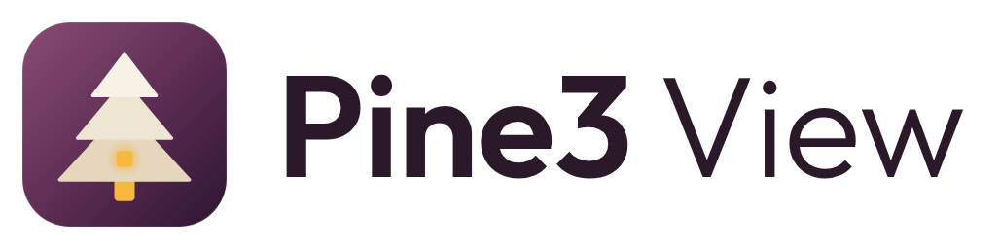
  </picture>
</p>

<p align="center"><a href="README.md">English</a> · <b>Português</b></p>

Painel pessoal para o Home Assistant, inspirado no Apple Home. Organiza a casa automaticamente
por divisão (Áreas → Dispositivos → Entidades), sem YAML, e junta uma vista 3D da casa que tu
próprio desenhas. Código original, feito de raiz.

## Capturas de ecrã

| Início | Casa 3D |
|---|---|
| 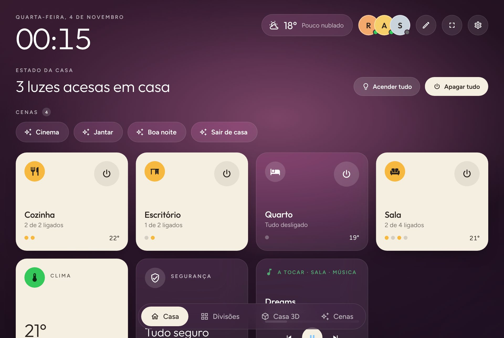 | 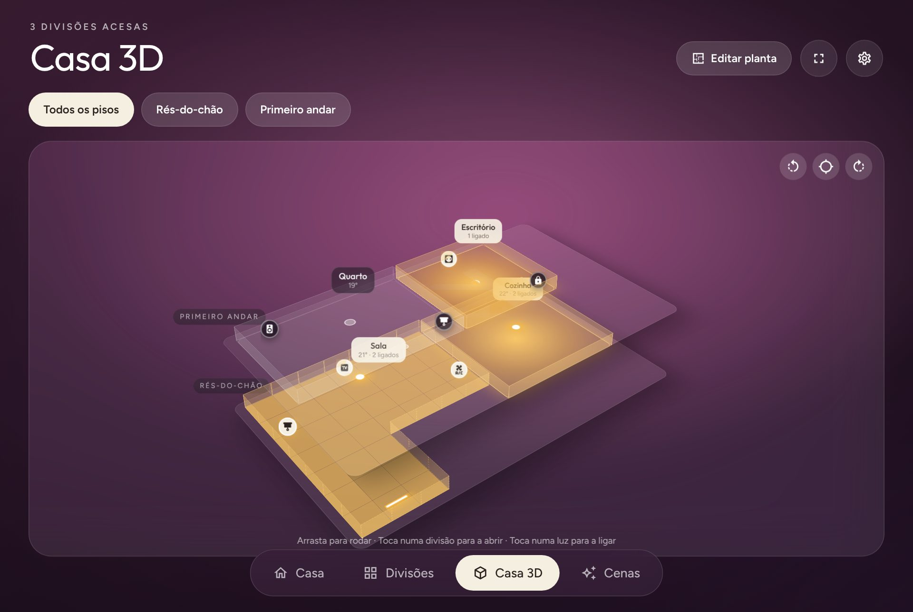 |
| **Divisão** | **Previsão do tempo** |
| 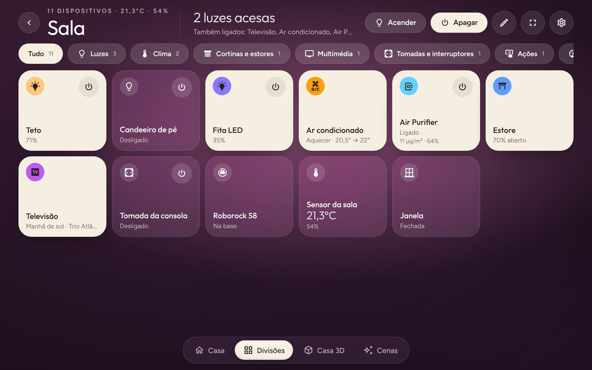 | 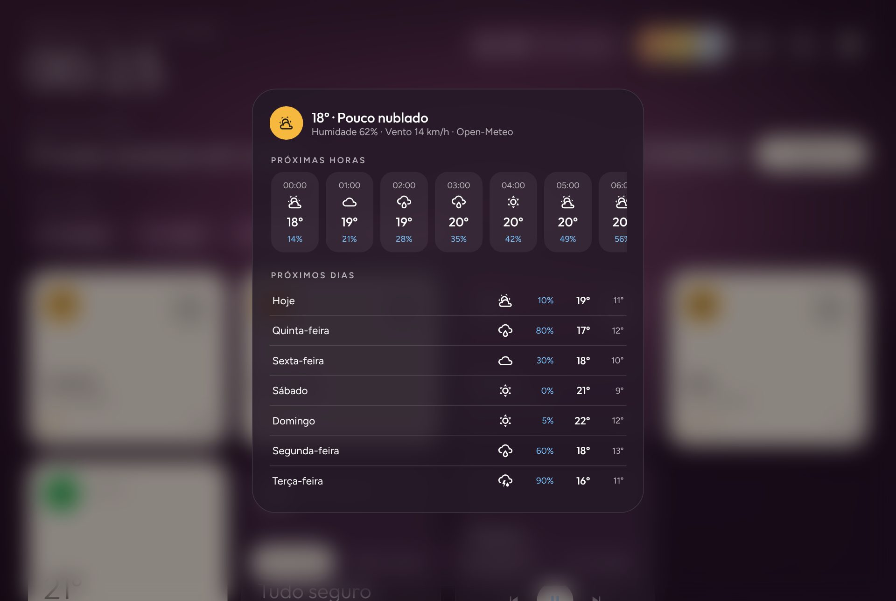 |
| **Planta: formas livres** | **Planta: dispositivos** |
| 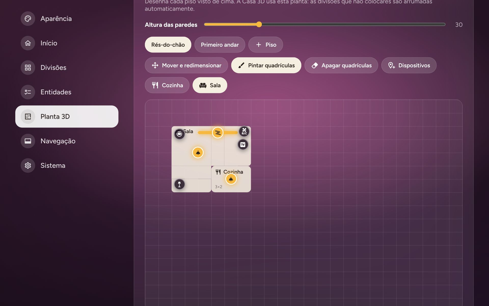 | 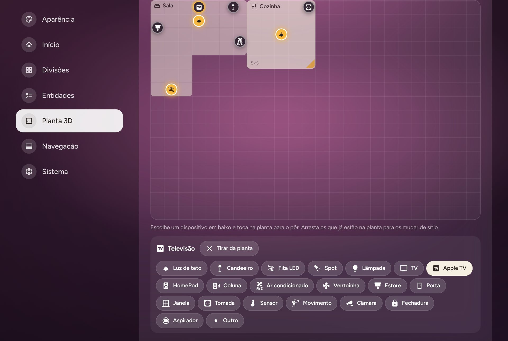 |
| **Casa 3D, rés-do-chão** | **Modo de edição** |
| 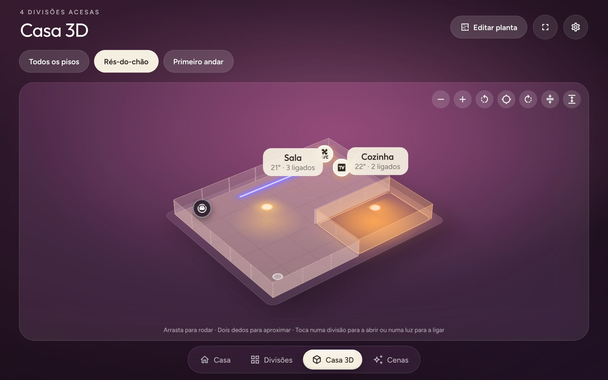 | 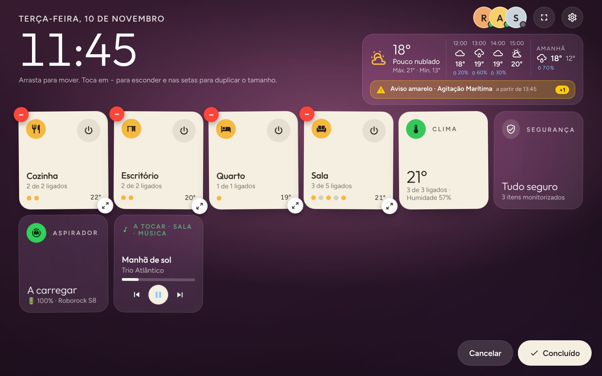 |
| **Definições: aparência** | **Definições: entidades** |
| 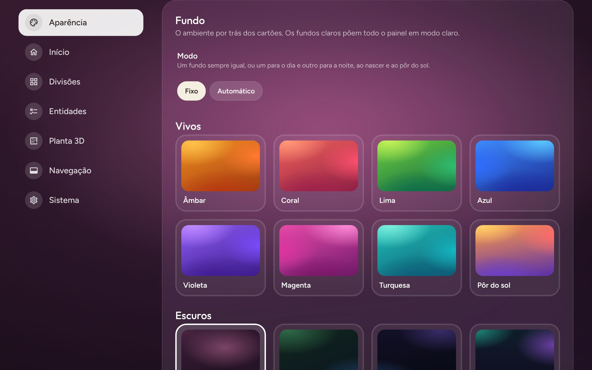 | 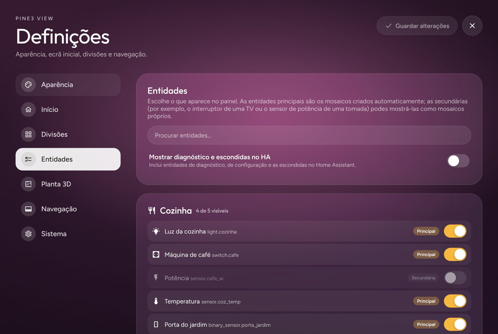 |
| **Este dispositivo (ecrã inteiro)** | **Lista, em inglês** |
| 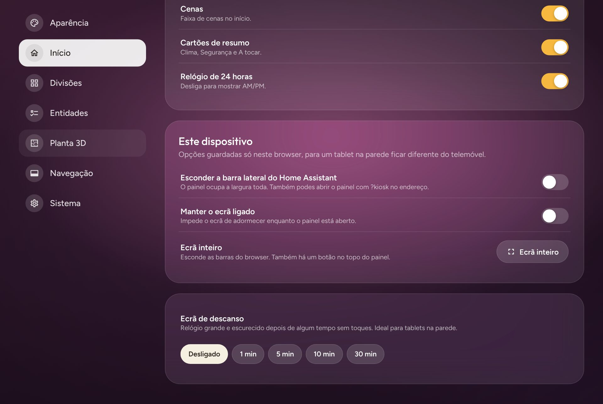 | 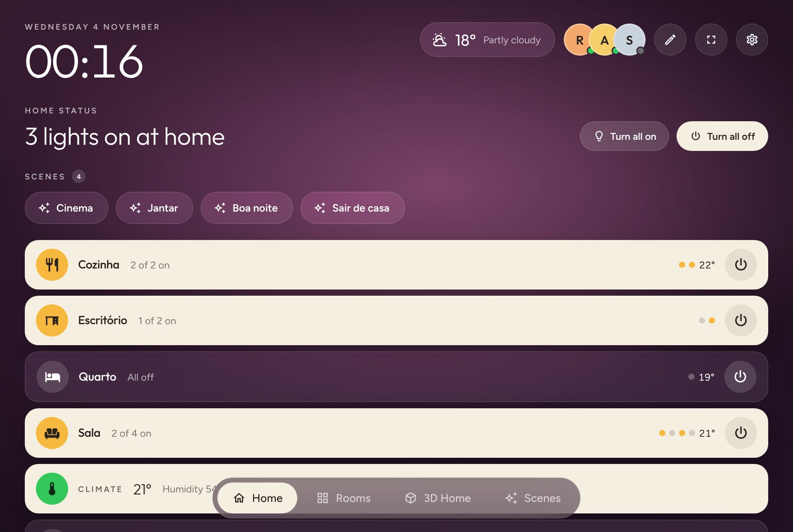 |
| **Ecrã de descanso** | |
| 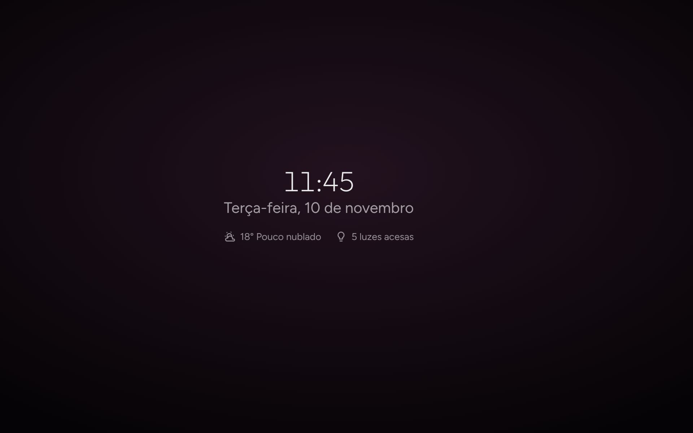 | |

No telemóvel:

| Início | Detalhe de uma luz | Casa 3D |
|---|---|---|
| 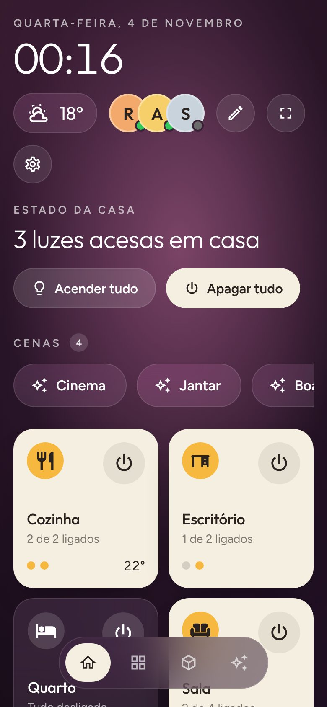 | 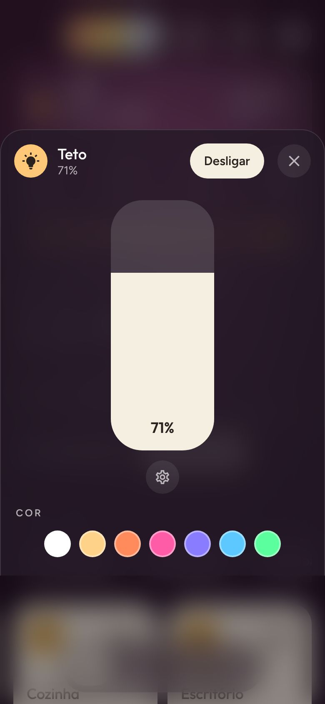 | 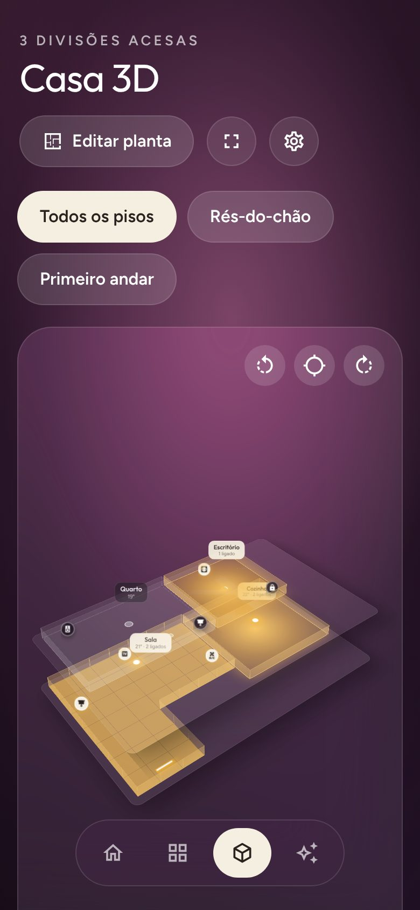 |

*Capturas feitas com uma casa de exemplo.*

## Instalar com HACS
1. No Home Assistant abre **HACS** → menu **⋮** → **Repositórios personalizados**.
2. Repositório: `https://github.com/pinheirofilipem-ux/pine3-view`, categoria **Integração** → **Adicionar**.
3. Procura **Pine3 View**, abre e carrega em **Transferir**.
4. Reinicia o Home Assistant.
5. **Definições → Dispositivos e serviços → Adicionar integração → Pine3 View**.
6. Abre **Pine3 View** na barra lateral.

Requer Home Assistant 2024.7 ou mais recente (o ícone da integração precisa da 2026.3 ou mais recente).
Para atualizar, transfere a nova versão no HACS e reinicia o Home Assistant; o browser vai buscar os ficheiros novos sozinho.

### Instalação manual
Copia `custom_components/pine3_view` para `/config/custom_components/`, reinicia e adiciona a integração.

## Funcionalidades
- **Início**: relógio, tempo (toca para ver a previsão), pessoas, estado da casa com *Acender/Apagar tudo*, cenas, cartões de divisão e de resumo (Clima, Segurança, A tocar).
- **Tempo**: usa a entidade de tempo do Home Assistant ou, se não houver, a [Open-Meteo](https://open-meteo.com) para a localização da casa (sem chave). Previsão das próximas 12 horas e 7 dias.
- **Casa 3D**: cada divisão é um bloco, empilhado por piso (pisos do HA). As divisões acesas brilham, as luzes aparecem como pontos que podes ligar e desligar, arrastas para rodar e tocas numa divisão para a abrir. A base de cada piso tem só o tamanho das suas divisões e a **altura das paredes** é ajustável (botões ↕ na Casa 3D ou um controlo deslizante nas definições).
- **Editor da planta** (*Definições → Planta 3D*, ou *Editar planta* na Casa 3D), visto de cima, um piso de cada vez:
  - **Mover e redimensionar**: desenhas as divisões como retângulos, arrastas para mover, puxas o canto para redimensionar, mudas de piso ou crias pisos novos. *Gerar planta automática* dá um ponto de partida.
  - **Pintar / apagar quadrículas**: dá a uma divisão qualquer forma de ângulos retos (L, U, T…). Pintar por cima de outra divisão passa-lhe essas quadrículas.
  - **Dispositivos**: pões cada entidade no sítio certo. O tipo é detetado automaticamente (luz de teto, candeeiro, fita LED, spot, TV, Apple TV, HomePod, coluna, ar condicionado, estore, porta, janela, tomada, sensor, câmara…) e podes mudá-lo. Na Casa 3D as luzes brilham no sítio (as de teto no alto, a fita LED como uma faixa) e os outros aparelhos são ícones que abrem o detalhe.
  - As divisões que não colocares são arrumadas automaticamente.
- **Entidades** (*Definições → Entidades*): todas as entidades de cada divisão, com pesquisa. Esconde mosaicos que não queres ou mostra entidades secundárias (o interruptor de uma TV, a potência de uma tomada, sensores de diagnóstico) como mosaicos próprios.
- **Cartão do dispositivo inteiro**: o cartão de detalhe mostra tudo o que o dispositivo expõe — leituras numa grelha (PM2.5, índice de alérgenos, humidade, vida do filtro…) e os controlos (interruptores, opções, números, botões), além dos modos de ventoinhas e purificadores. As listas de opções (modo da luz, temporizador…) são mosaicos compactos que abrem uma fila de botões. Ideal para purificadores de ar (ex.: Philips), aspiradores ou ar condicionado; um mosaico em tamanho duplo mostra até 6 leituras.
- **Clima e ar condicionado** (ex.: Tado via HomeKit): anel com a temperatura-alvo ou o intervalo de aquecer/arrefecer (mínima e máxima), o que o aparelho está a fazer (a aquecer, a arrefecer, inativo…), temperatura e humidade atuais, os modos e, quando o aparelho os expõe, velocidade da ventilação, oscilação e perfis. Termóstatos e ar condicionado têm ícones próprios.
- **Apple TV e HomePod** (integração *Apple TV* do HA): ícones próprios e a app ou música que está a tocar.
- **Modo de edição** (✎): arrasta para reordenar divisões e dispositivos, toca em − para esconder e nas setas para duplicar o tamanho (um cartão de divisão duplo mostra atalhos para os dispositivos).
- **Disposição**: grelha ou lista. Ao mudar de ecrã na dock, uma lente de vidro desliza até ao novo separador e o ecrã entra suavemente (*Definições → Aparência → Animações* desliga isto).
- **Ecrã de descanso**: relógio grande e escurecido após 1–30 min sem toques.
- **Ecrã inteiro e modo quiosque**: o botão ⛶ põe o browser em ecrã inteiro. Em *Definições → Início → Este dispositivo* escondes a barra lateral do Home Assistant e manténs o ecrã ligado (só nesse dispositivo). Abrir o painel com `?kiosk` no endereço (ex.: `http://homeassistant.local:8123/pine3-view?kiosk`) também esconde a barra lateral, ideal para um tablet na parede.
- **Idioma**: Português ou English, escolhido nas definições.

## Definições
Botão ⚙ no canto superior direito:
- **Aparência**: idioma, disposição, cor dos cartões, cor de destaque e fundo, com pré-visualização ao vivo.
- **Início**: meteorologia e fonte do tempo, pessoas, estado da casa, cenas, cartões de resumo, relógio 12/24 h, ecrã de descanso e as opções deste dispositivo (barra lateral, ecrã ligado, ecrã inteiro).
- **Divisões**: ordenar, esconder e escolher o tamanho de cada divisão na planta automática; voltar a mostrar dispositivos escondidos.
- **Entidades**: escolher exatamente o que aparece.
- **Planta 3D**: o editor acima e a altura das paredes.
- **Navegação**: botões do dock (Divisões, Casa 3D, Cenas, Segurança).
- **Sistema**: versão, contagens, reconstruir agora, repor predefinições.

As definições ficam guardadas no Home Assistant e valem para todos os dispositivos, exceto as de *Este dispositivo*, que ficam em cada browser.

## Como se constrói sozinho
O servidor (`discovery.py`) lê os registos do Home Assistant e monta a casa:
- **Áreas → divisões**, ordenadas por piso e nome; ícone escolhido pelo nome (Cozinha, Quarto, Casa de banho… em português ou inglês).
- **Dispositivos → mosaicos**: cada dispositivo dá um mosaico, com a entidade principal (clima > multimédia > estores > luz > tomada…). Os sensores do mesmo dispositivo (potência, bateria, humidade) aparecem como extras no mosaico.
- Relés de vários canais dão um mosaico por canal. O nome da divisão é retirado do nome do dispositivo ("Sala Candeeiro" → "Candeeiro").
- Entidades escondidas, desativadas, de diagnóstico ou configuração ficam de fora (podes trazê-las de volta em *Entidades*).
- Sensores de temperatura e humidade alimentam o resumo de cada divisão.
- Quando adicionas ou mudas dispositivos ou áreas no HA, o painel atualiza-se sozinho.

## Visual
Fundo ameixa (e mais 5), cartões creme quando ligados, botão de energia por divisão e por dispositivo,
pontos de estado, cartões de Clima, Segurança e "A tocar", dock em pílula.
Tipografia: [Outfit](https://github.com/Outfitio/Outfit-Fonts) e [Figtree](https://github.com/erikdkennedy/figtree), ambas SIL OFL 1.1 (licenças em `frontend/fonts/`).
O ícone e o logótipo estão em `custom_components/pine3_view/brand/` (origem: `docs/brand/source.html`).

## Testes
```
pip install -r requirements_test.txt
pytest
```

## Roadmap
Câmaras no início, leitor Spotify, mais tipos de dispositivo para a planta.

## Licença
MIT (ver `LICENSE`). As fontes Outfit e Figtree estão sob a SIL Open Font License 1.1 (ver `NOTICE`).
